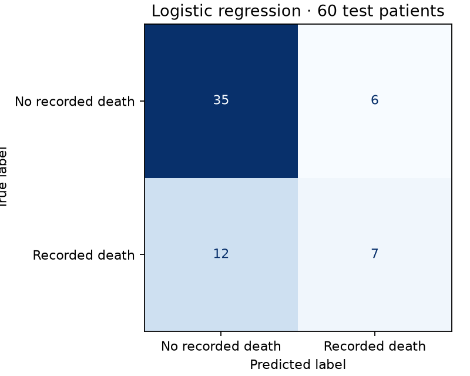

# Heart Failure Mortality Prediction | AIPI 510

**Authors:** Alberto Gomez and Samuel Teshome

A simple, reproducible machine learning pipeline that predicts whether a heart failure patient died during follow-up (`DEATH_EVENT`) from 11 clinical measurements.

## Results

Logistic regression, evaluated once on 60 held-out test patients:

| Metric | Logistic regression | Baseline (always predicts survival) |
| --- | ---: | ---: |
| **Test accuracy** | **70.0%** | 68.3% |
| Recall (deaths detected) | 36.8% (7 of 19) | 0.0% (0 of 19) |
| Precision | 53.8% | — |

5-fold cross-validated accuracy on the training set: **74.5%** (baseline 67.8%).



Full metrics for both models are saved in [`results/metrics.json`](results/metrics.json).

The model beats the baseline modestly on accuracy, but it identifies 7 of 19 deaths while the baseline identifies none. With only 299 patients and the follow-up time excluded, the remaining features carry limited signal.

## Pipeline

| Step | File | What it does |
| --- | --- | --- |
| 1. Prepare | `prepare.py` | Loads the CSV, selects 11 features, makes a stratified 80/20 split (`random_state=42`), and defines the preprocessing (scale 6 numeric features, keep 5 binary features as-is) |
| 2. Train | `train.py` | Fits logistic regression and a majority-class baseline, reports 5-fold CV accuracy, and saves both to `artifacts/` |
| 3. Evaluate | `evaluate.py` | Scores both saved models on the test set (accuracy, precision, recall, confusion matrix) and writes `results/metrics.json` and `results/confusion_matrix.png` |
| Explore (optional) | `eda.py` | Summary statistics of the training data |

Scaling happens inside the scikit-learn pipeline, so it is learned from the training data only and no test information leaks into training.

**Why `time` is excluded:** it records the length of follow-up, which is only known after the outcome. Patients who died tend to have short follow-ups, so including it would inflate the score without being usable for real prediction.

## How to run

From the repository root on macOS or Linux:

```sh
python3 -m venv .venv
source .venv/bin/activate
python -m pip install -r requirements.txt
bash run_pipeline.sh
```

The dataset is bundled in `data/`, so the pipeline runs offline after installing dependencies.

## Dataset

[Heart Failure Clinical Records](https://archive.ics.uci.edu/dataset/519/heart+failure+clinical+records) (UCI Machine Learning Repository): 299 patients, 12 features, no missing values. Redistributed unchanged under [CC BY 4.0](https://creativecommons.org/licenses/by/4.0/). [DOI: 10.24432/C5Z89R](https://doi.org/10.24432/C5Z89R)

Chicco, D., & Jurman, G. (2020). [Machine learning can predict survival of patients with heart failure from serum creatinine and ejection fraction alone](https://doi.org/10.1186/s12911-020-1023-5). *BMC Medical Informatics and Decision Making*, 20, 16.
